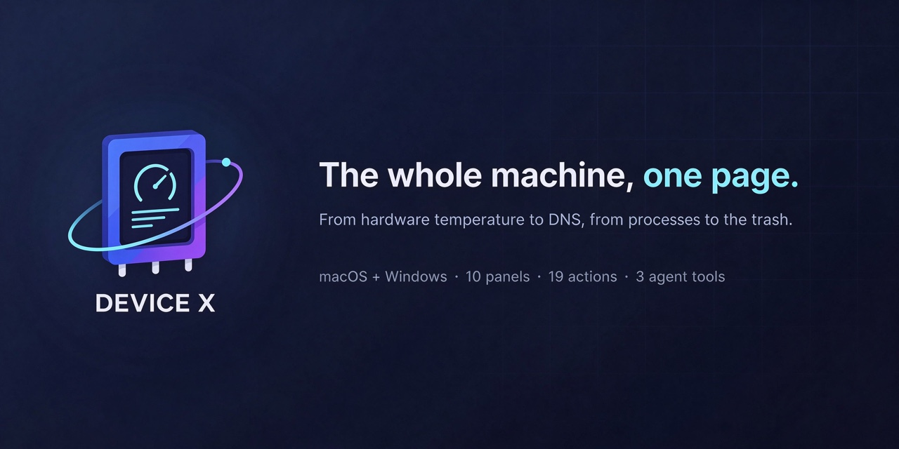
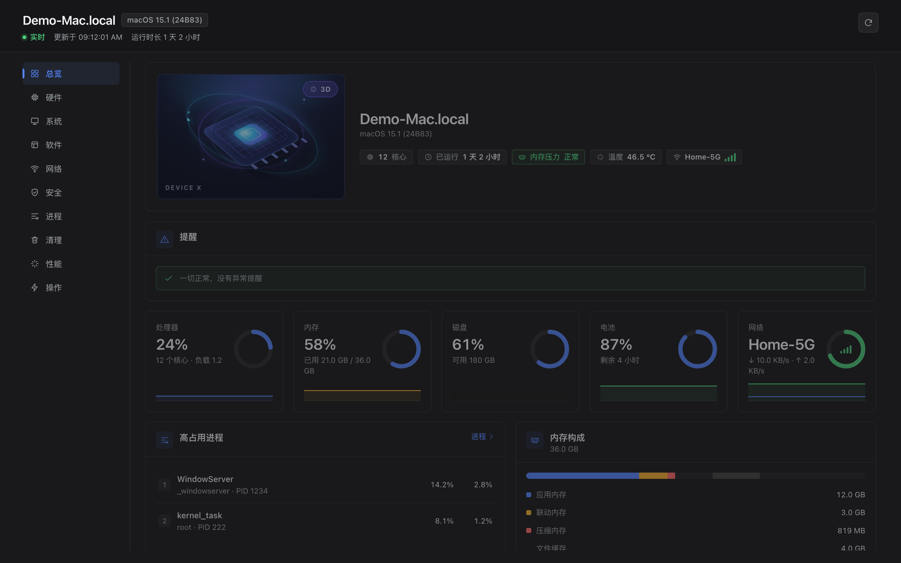
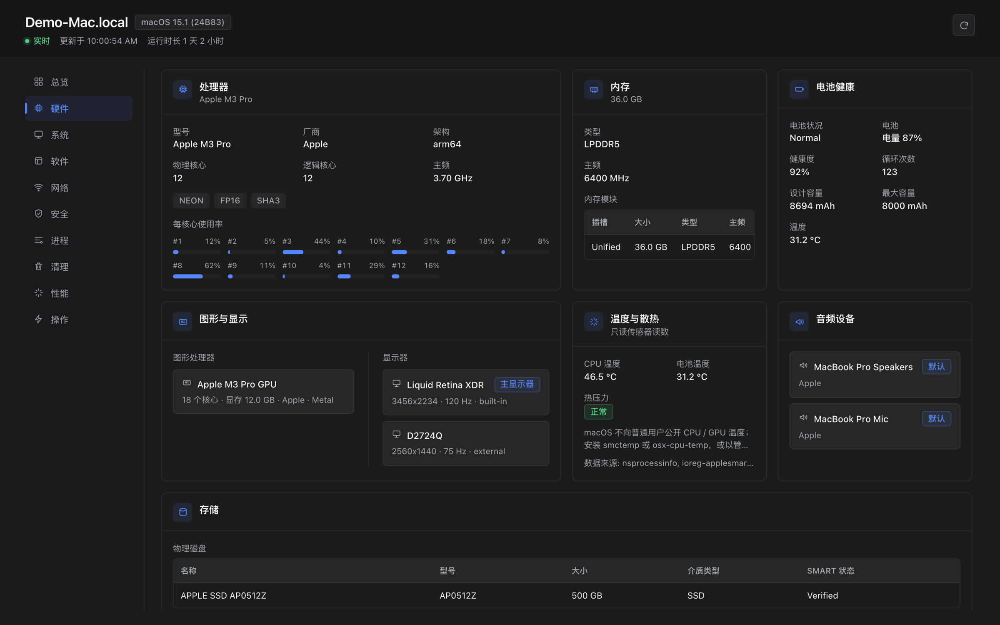
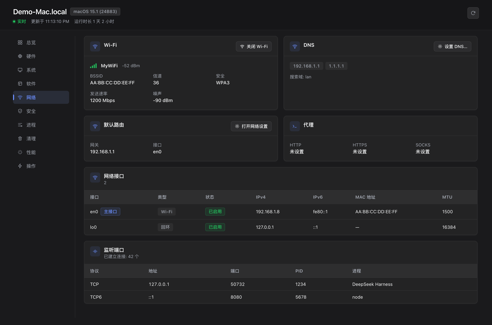
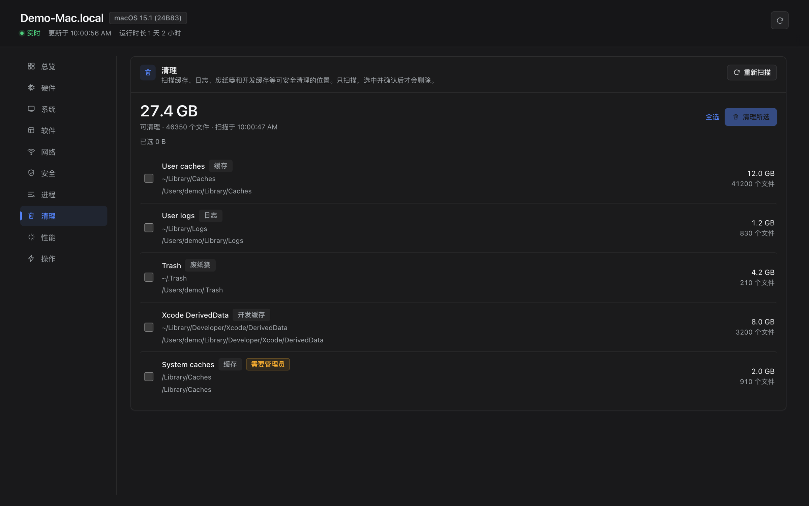

# Device X · dsh-plugin-devicex

[简体中文](README.md) | English

[](https://github.com/cfour-hi/dsh-plugin-devicex/actions/workflows/verify.yml)
[](https://www.npmjs.com/package/@cfour-hi/dsh-plugin-devicex)
[](#verification-and-development)
[](LICENSE)
[](#known-limitations)



One page, in Chinese or English, shows you the whole machine — hardware, system, software, network,
security and processes — and lets you act on everything **that isn't hardware**: end processes,
uninstall apps and clean up their leftovers, change hostname/volume/dark mode, toggle Wi-Fi/firewall,
set DNS, empty the Trash, sleep or lock the screen… It also ships confirmable disk cleanup and a
repeatable local benchmark. The same capabilities are exposed to agent models as three tools:
`device_info` / `device_control` / `device_benchmark`.

**Platforms**: macOS and Windows 10/11. The Host picks an implementation by `process.platform`
(`darwin` uses system commands, `win32` uses PowerShell/CIM); the browser UI, HTTP API and agent tools
are identical on both.
**Entry**: the **Device X** icon at the bottom of the left sidebar → the centre panel. Colours come only
from theme tokens, so it follows light/dark mode and honours `prefers-reduced-motion`. A failed action
reports its error only inside the relevant card or dialog; it never takes down the page.

## Interface

> Screenshots are real renders of the plugin UI (the Chinese locale is shown; the panel also ships a
> full English dictionary and follows the host locale). Hostname, account, serial, MAC and LAN addresses
> are replaced or hidden.





<p align="center">
  
  
</p>

| Tab | Contents |
|---|---|
| Overview | CSS 3D device core, five donut KPIs, sparklines, top processes, derived alerts |
| Hardware | CPU and per-core usage, memory, graphics & displays (GPU/displays in one card), disk, battery health, thermals & cooling, drivers, connected devices (USB/Bluetooth switch), audio, cameras |
| System | OS & kernel, model & serial, uptime, user table, login items & LaunchAgents (enable/disable), environment variables |
| Software | App search/filter/sort, reveal, uninstall (with [leftover cleanup](#uninstall-leftover-cleanup)); Homebrew / winget list (switch beside the title, outdated tag with hover tooltip) |
| Network | Interfaces, Wi-Fi signal, DNS, default route, proxy, TCP listeners & connection counts; toggle Wi-Fi, set DNS |
| Security | FileVault/SIP/Gatekeeper/TCC or BitLocker/Defender/UAC, firewall, administrators, privacy settings panes, flush DNS |
| Processes | Searchable, sortable process table; end per row (TERM/KILL/INT/STOP/CONT) with confirmation |
| Cleanup | Scan caches/logs/Trash/developer caches, showing size and file count; select, then confirm before deleting |
| Benchmark | CPU single/multi-core, memory bandwidth, disk read/write; compare with the last run — only meaningful on the same machine over time |
| Actions | 19 allowlisted actions per platform, grouped on screen, forms generated from the parameter catalogue, dangerous actions double-confirmed, plus action history |

## Installation

```sh
# Install straight from GitHub (the other side needs no local source)
dsh plugin --profile desktop add https://github.com/cfour-hi/dsh-plugin-devicex

# Or from a local directory / tgz
npm run release:pack
dsh plugin --profile desktop add /absolute/path/cfour-hi-dsh-plugin-devicex-<version>.tgz
```

A running session can also hot-install without a restart via
`plugin_manager action=install_bundle target=<path or repository URL>`. The root `package.json` is the
Git-install entry point, while `plugin/package.json` serves local linking and tgz packages; the two
manifests must stay in sync (`verify.mjs` checks them field by field). Prerequisites, permissions and
the uninstall/update steps are in [docs/INSTALL.md](docs/INSTALL.md).

## What it can do

19 allowlisted actions per platform (20 ids across both: `brewUninstall` and `wingetUninstall` each
belong to one end), with parameters generated from the catalogue and validated item by item; dangerous
actions are double-confirmed.

| Group | Actions | Description |
|---|---|---|
| process | `process.signal` | TERM/KILL/INT/STOP/CONT; refuses PID 1 and the Host process itself |
| app | `app.quit` · `app.launch` · `app.reveal` · `app.uninstall` | Quit / launch / reveal in the file manager / uninstall (on macOS limited to three app directories and refuses system apps; on Windows accepts `msi:{GUID}`, `winget:<id>` or an uninstall registry key — never an arbitrary shell string) |
| system | `system.setHostname` · `setVolume` · `setDarkMode` · `launchAgent` · `openSettings` · `toggleFirewall` · `flushDNS` · `emptyTrash` · `cleanup.delete` | Hostname / volume 0–100 / dark mode / load or unload a LaunchAgent or startup item / open one of 23 Settings panes / firewall / flush DNS / empty the Trash or Recycle Bin / delete selected cleanup items |
| network | `network.setWifiPower` · `setDns` | Wi-Fi toggle; set 0–4 DNS servers (accepts a service name or interface name) |
| power | `power.sleep` · `power.lock` | Sleep / lock |
| software | `software.brewUninstall` · `software.wingetUninstall` | Uninstall a package-manager formula or package |

Windows keeps the same action ids with platform implementations: `Stop-Process`, `Rename-Computer`,
`ms-settings:`, `Enable/Disable-NetAdapter`, `Set-DnsClientServerAddress`, `Clear-RecycleBin` and so on.

**Security model**: same-origin `/devicex/api/*`, behind DSH's Connection trust fence (signed session
cookie + Host/Origin validation; unauthenticated 401, cross-origin 403). Child processes always use
`execFile` with an argument array, never a shell; path parameters are checked against allowed roots and
suffixes; `cleanup.delete` accepts only fixed ids returned by the scan, never paths (1–20, deduplicated);
every action — failed ones included — lands in a 50-entry ring history.

## Uninstall leftover cleanup

Dragging an app to the Trash deletes only the `.app`; its data stays behind in `~/Library`. Before
uninstalling, Device X scans those scattered data directories and **lists them for per-item selection**.

| Tier | Basis | Preselected |
|---|---|---|
| A · high confidence | Bundle ID match, MSIX package container, Homebrew cask `zap` list | ✅ |
| B · name candidate | Directory name resembles the app name and matches exactly one installed app | ❌ |
| C · conflict candidate | The same directory matches ≥2 installed apps | ❌ |
| D · shared/restricted | Vendor-level directory (`Google/`, `Microsoft/`) or needs administrator rights | No checkbox |

B/C are shown but not preselected — in a real measurement `Application Support/Claude-3p` held 11 GB
yet contained no bundle id, so only the name heuristic could find it; hiding it would silently give up
11 GB on the user's behalf. The modal footer always shows "N more items unselected (X total)".

Three invariants: **deletion never accepts a path** — the browser only receives item ids, full paths
stay in Host memory, the one-time `scanId` is bound to a single scan, and after `realpath` the item must
still sit inside an allowed root; **a failed uninstall aborts globally**, not a single byte is deleted,
and a running app is rejected outright; **everything is moved to the Trash**, with the result page
stating "Emptying the Trash frees X". Windows can list but not clean — see
[known limitations](#known-limitations). The full scan and token design is in the
[design doc](docs/uninstall-footprint-design.md).

## Agents and automation

- `device_info`: `section` picks one of eight sections, `fresh` bypasses the cache.
- `device_control`: `action` + `params`, sharing the exact same implementation as the UI — never two sets of logic.
- `device_benchmark`: `tests?`, `repeat?`, using the same engine as the Benchmark tab.

The UI reads through 7 same-origin routes under `/devicex/api` (`metrics`, `inventory`, `actions`,
`action`, `cleanup`, `footprint`, `benchmark`; `cache-control: no-store`, a business failure is still
HTTP 200). The exact request bodies, error codes and response envelope are specified in the
[build contract](docs/build-contract.md).

## Architecture

```
plugin/
├── index.js              # Host entry: warmup + 7 routes + 3 tools
├── host/
│   ├── collector*.js     # Platform collectors (system commands / PowerShell+CIM), TTL cache & warmup
│   ├── actions*.js       # 19 allowlisted actions per platform
│   ├── cleanup*.js       # Allowlisted cleanup scan and deletion
│   ├── footprint*.js     # Leftover scan: pure core + platform impl + one-time token
│   ├── uninstall.js      # Uninstall pipeline (validation gates, zero side effects on failure)
│   ├── benchmark.js      # CPU/memory/disk benchmark (worker_threads)
│   ├── win.js + win/*.ps1 # PowerShell bridge and seven read-only collector scripts
│   ├── transport.js      # Route registration + trust fence + JSON envelope
│   └── tool.js           # Schemas and rendering for the three agent tools
└── client.js             # Build artifact (don't edit by hand; change the source, then npm run build)

src/client/               # Browser-side TSX source (10 tabs + 43 components)
```

The browser half is bundled by esbuild into a single IIFE (227 KB, requesting `react` from the loader
exactly once); the committed `plugin/client.js` is self-contained with zero runtime dependencies. In an
environment without a bundler, `npm run build:concat` produces an equivalent artifact (335 KB).
[types/contracts.ts](types/contracts.ts) is a pure type file defining the frozen shapes shared by
Host ↔ API ↔ client.

## Verification and development

```sh
npm run verify:ci    # one command for the whole gate (same as CI)
```

Run individually: `npm test` (119 unit tests), `verify.mjs` (96 general regression checks),
`verify-windows.mjs` (167, fixtures only — no real machine needed), `verify-sensors.mjs` (57 thermal/
driver checks), `verify-cleanup.mjs` (130, real scan + sandboxed deletion), `verify-benchmark.mjs` (46),
`verify-footprint.mjs` (72 leftover checks), `render-check.mjs` (282 client render assertions) — 969 checks
in total. `verify:ci` additionally enforces `build-client --check`, `typecheck` and the artifact check,
so **a stale artifact never passes CI**.

`verify-footprint.mjs` pins the pitfalls found during real measurements as regressions: Team ID prefixes,
`Claude-3p` name matching, vendor-directory false positives, single-use tokens and cross-scan mixing,
zero side effects when uninstall fails, and `moveToTrash` never overwriting an existing item.

After changing `plugin/`, re-run `install_bundle` or restart Harness. For UI changes, edit `src/client/`,
run `npm run build`, then `npm run verify:ci`.

## Known limitations

- **Windows has not been verified on real hardware**: everything passes via fixtures, static checks and a
  simulated win32 Host. Real PowerShell 5.1 CIM field differences and admin-required queries/actions
  still need confirmation on a physical machine.
- **Uninstall leftovers on Windows can be listed but not cleaned**: moving items to the Recycle Bin
  requires the shell and has not been verified on real hardware, so a request carrying a `scanId` returns
  `UNSUPPORTED_PLATFORM` rather than silently discarding the user's selection.
- Admin-required actions (hostname, firewall, startup items, DNS, Wi-Fi toggle) return the command error
  verbatim on failure; they never pretend to have succeeded.
- macOS automation permission (quit app, dark mode, lock screen) may be denied by TCC on first use;
  Apple Silicon does not expose CPU/GPU temperature to normal users, so `thermal.cpuCelsius` is `null`
  with an explanatory `note` rather than a fabricated value.
- Cleanup and leftovers: `~/.Trash` and some system caches are TCC-protected, so a scan honestly returns
  `EPERM`. The pipeline does not depend on enumerating the Trash and does not promise "always restorable".
- Benchmark scores are only for comparing the same machine over time, not against other benchmark suites;
  machine load affects a single run.
- The port list contains TCP LISTEN sockets only; non-admin users cannot see ports of some system processes.

## License

[MIT](LICENSE) © 2026 cfour-hi. The root `LICENSE` is the single source of truth; `plugin/LICENSE` is
the packaged copy and must be byte-identical.

---

More detail: [Build contract](docs/build-contract.md) · [Windows contract](docs/windows-contract.md) ·
[Release flow](docs/RELEASE.md) · [Install guide](docs/INSTALL.md)
