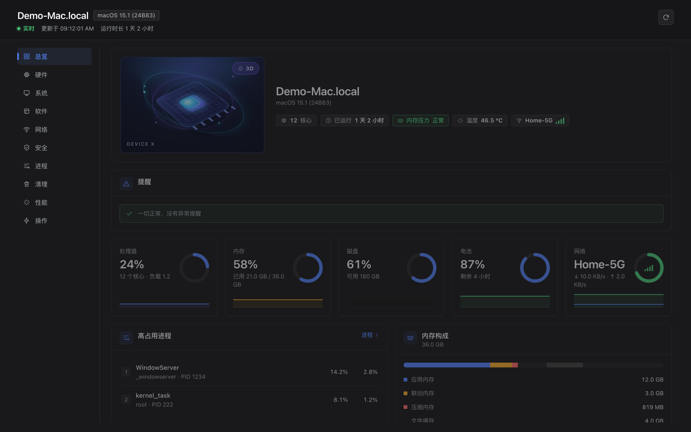
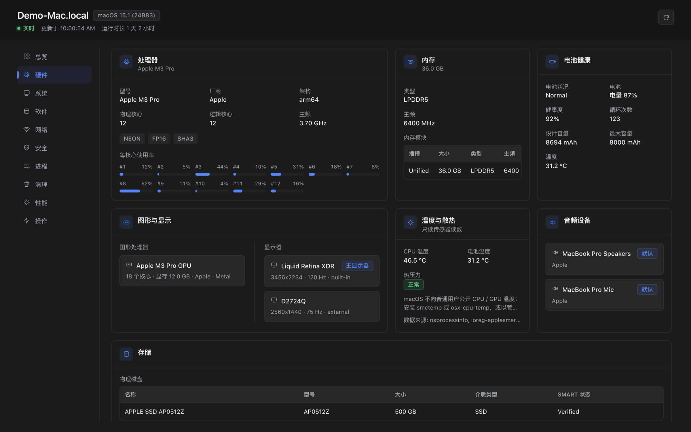
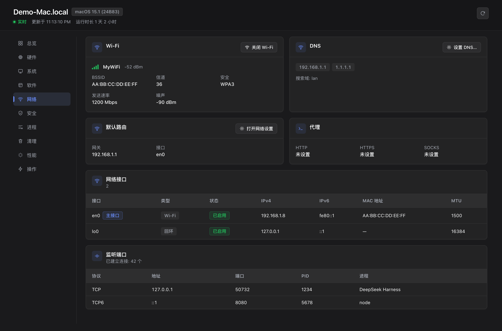
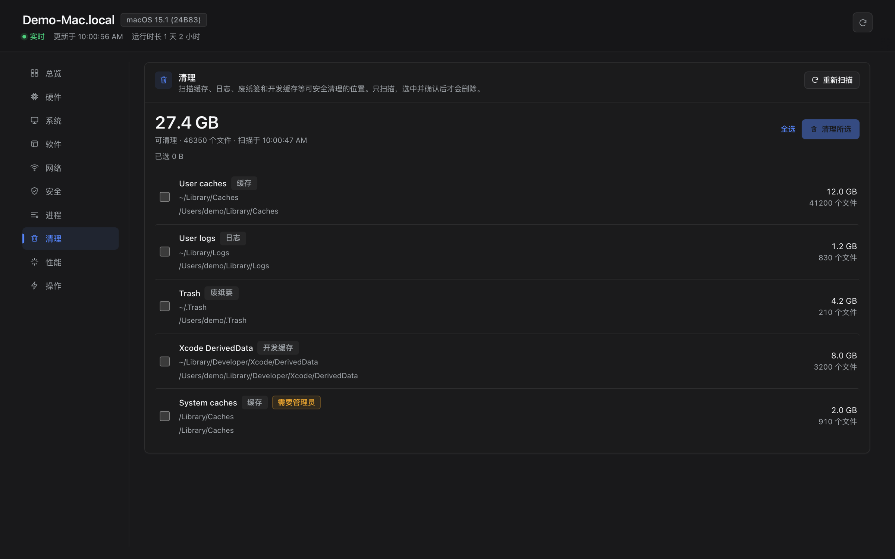

# Device X · dsh-plugin-devicex

一页中文/英文界面看尽本机硬件、系统、软件、网络、安全与进程，并对**非硬件**的一切直接操作——结束进程、
卸载应用并清理残留、改主机名/音量/深色模式、开关 Wi-Fi/防火墙、设 DNS、清空废纸篓、睡眠锁定……
还内置可确认的磁盘清理与可重复的本机基准测试。同一套能力以 `device_info` / `device_control` /
`device_benchmark` 三个工具暴露给 Agent 模型。

**平台**：macOS 与 Windows 10/11。Host 按 `process.platform` 选实现（`darwin` 用系统命令，`win32` 用
PowerShell/CIM），浏览器 UI、HTTP API、Agent 工具两端完全一致。
**入口**：左侧栏底部 **Device X** 图标 → 中央面板；仅使用主题 token 着色，跟随浅色/深色，支持
`prefers-reduced-motion`。失败动作只在对应卡片或弹窗内报错，不会让页面崩溃。

## 界面

> 截图为插件真实渲染，主机名、账号、序列号、MAC 与内网地址已替换或隐藏。





<p align="center">
  
  
</p>

| 标签 | 内容 |
|---|---|
| 总览 | CSS 3D 设备核心、五个环形 KPI、火花线、Top 进程、派生告警 |
| 硬件 | CPU 与逐核、内存、GPU、显示器、磁盘、电池健康、温度与散热、驱动、USB/蓝牙/音频/摄像头 |
| 系统 | 系统与内核、型号序列号、运行时长、用户表、登录项与 LaunchAgents（可启停）、环境变量 |
| 软件 | 应用搜索/过滤/排序、定位、卸载（含[残留清理](#卸载残留清理)）；Homebrew / winget 状态 |
| 网络 | 网卡、Wi-Fi 信号、DNS、默认路由、代理、TCP 监听与连接数；开关 Wi-Fi、设 DNS |
| 安全 | FileVault/SIP/Gatekeeper/TCC 或 BitLocker/Defender/UAC、防火墙、管理员、隐私设置页、刷新 DNS |
| 进程 | 可搜索排序的进程表，逐行结束（TERM/KILL/INT/STOP/CONT），二次确认 |
| 清理 | 扫描缓存/日志/废纸篓/开发缓存，显示体积与文件数；勾选后二次确认才删除 |
| 性能 | CPU 单/多核、内存带宽、磁盘读写；与上次运行对比，仅适合同机前后比较 |
| 操作 | 19 个白名单动作按组呈现，表单由参数目录生成，危险动作二次确认，含操作历史 |

## 动作清单（19 项，白名单 + 严格参数校验）

| 动作 | 说明 |
|---|---|
| `process.signal` | TERM/KILL/INT/STOP/CONT；拒绝 PID 1 与 Host 自身 |
| `app.quit` / `app.launch` / `app.reveal` | 退出 / 启动 / 在文件管理器中显示 |
| `app.uninstall` | 卸载 `.app` 或 MSI/winget/注册表项；macOS 仅限三个应用目录并拒绝系统应用；可选级联清理残留 |
| `system.setHostname` | HostName / ComputerName / LocalHostName（字符与长度校验） |
| `system.setVolume` / `system.setDarkMode` | 音量 0–100 / 深色模式 |
| `system.launchAgent` | 启停 LaunchAgent 或 Windows 启动项（路径白名单） |
| `system.openSettings` | 打开系统设置面板（21 项白名单） |
| `system.toggleFirewall` / `flushDNS` / `emptyTrash` | 防火墙开关 / 刷新 DNS / 清空废纸篓或回收站 |
| `cleanup.delete` | 删除扫描选中的项；只接受扫描返回的固定 id，绝不接受路径（1–20 个、去重） |
| `network.setWifiPower` / `setDns` | Wi-Fi 开关 / 设置 0–4 个 DNS（接受服务名或网卡名） |
| `power.sleep` / `power.lock` | 睡眠 / 锁定 |
| `software.brewUninstall` / `software.wingetUninstall` | 卸载包管理器公式或包 |

Windows 用相同动作 id 的平台实现：`Stop-Process`、`Rename-Computer`、`ms-settings:`、
`Enable/Disable-NetAdapter`、`Set-DnsClientServerAddress`、`Clear-RecycleBin` 等；`app.uninstall` 参数改为
`id`（`msi:{GUID}` / `winget:<id>` / 卸载注册表键），不执行任意 shell 字符串。

**安全模型**：同源 `/devicex/api/*`，落在 DSH 的 Connection 信任栅栏之后（签名会话 cookie + Host/Origin
校验，未认证 401、异源 403）；子进程一律 `execFile` 参数数组，不经 shell；路径参数做根目录与后缀校验；
每次动作（含失败）进入 50 条环形历史。

## 卸载残留清理

应用拖进废纸篓只删了 `.app`，数据仍留在 `~/Library`。卸载时会先扫描散落的数据目录，**列出来供逐项勾选**。

| 档位 | 依据 | 默认勾选 |
|---|---|---|
| A 高置信 | Bundle ID 匹配、MSIX 包容器、Homebrew cask `zap` 清单 | ✅ |
| B 名称候选 | 目录名像 App 名，且只匹配到一个已装应用 | ❌ |
| C 冲突候选 | 同一目录匹配到 ≥2 个已装应用 | ❌ |
| D 共享/受限 | 厂商级目录（`Google/`、`Microsoft/`）或需管理员权限 | 无复选框 |

B/C 展示但不默认勾选——本机实测 `Application Support/Claude-3p` 占 11 GB 却不含任何 bundle id，
只有名称启发式能发现它；藏起来等于替用户放弃 11 GB。弹窗底部固定显示「另有 N 项未选中（共 X）」。

**删除永不接受路径**：`GET /devicex/api/footprint` 只读扫描并返回一次性 `scanId`，完整路径只留在 Host 内存；
浏览器只拿条目 id，`app.uninstall` 传 `scanId` + `itemIds`，Host 校验令牌未过期、未使用、属于该 scan，
且 `realpath` 后仍在允许的根列表内、非根目录、非符号链接。

**流水线**：扫描 → 勾选 → 卸载本体 → 校验确已卸载 → 复扫 → 逐项移入废纸篓。卸载失败或被取消则
**全局中止、一个字节都不删**；应用仍在运行时直接拒绝；没有自带卸载器不算失败；macOS 不执行 bundle 内
卸载器（现存两个都没有可验证的命令行契约）。一律移入废纸篓，结果页写明「清空废纸篓后释放 X」。

Windows 只能列出不能清理：移入回收站需走 shell 且未在真机验证，带 `scanId` 的请求返回
`UNSUPPORTED_PLATFORM`，不会静默丢弃用户的选择。详见 [设计文档](docs/uninstall-footprint-design.md)。

## Agent 工具

- `device_info`：`section` 取八个分区之一，`fresh` 绕过缓存。
- `device_control`：`action` + `params`，与 UI 走同一实现，不会出现两套逻辑。
- `device_benchmark`：`tests?`、`repeat?`，与「性能」页同一引擎。

## HTTP API

均以 `/devicex/api` 为前缀，同一来源，`cache-control: no-store`。

| 路径 | 说明 |
|---|---|
| `GET /metrics` | 实时指标（UI 每 2.5 s 轮询） |
| `GET /inventory[?section=&fresh=1]` | 完整清单或单个分区 |
| `GET /actions` · `POST /action` | 动作目录 / 执行动作（业务失败仍 HTTP 200） |
| `GET /cleanup[?fresh=1]` | 白名单清理扫描（60 s 缓存） |
| `GET /footprint[?path=&fresh=1]` | 只读残留扫描，返回一次性 `scanId` |
| `POST /benchmark` | 运行基准（body: `{ tests?, repeat? }`） |

## 架构

```
plugin/
├── index.js              # Host 入口：warmup + 7 条路由 + 3 个工具
├── host/
│   ├── collector*.js     # 平台采集（系统命令 / PowerShell+CIM），TTL 缓存与预热
│   ├── actions*.js       # 19 个白名单动作，两平台各一套实现
│   ├── cleanup*.js       # 白名单清理扫描与删除
│   ├── footprint*.js     # 残留扫描：纯内核 + 平台实现 + 一次性令牌
│   ├── uninstall.js      # 卸载流水线（校验门禁、失败零副作用）
│   ├── benchmark.js      # CPU/内存/磁盘基准（worker_threads）
│   ├── win.js + win/*.ps1 # PowerShell 桥与七个只读采集脚本
│   ├── transport.js      # 路由注册 + 信任栅栏 + JSON 信封
│   └── tool.js           # 三个 Agent 工具的 schema 与渲染
├── src/client/           # 浏览器端 TSX 源码（10 个标签页 + 41 个组件）
└── client.js             # 构建产物（勿手改，改源码后 npm run build）
```

浏览器端由 esbuild 打成单文件 IIFE（209 KB，只向 loader 要一次 `react`），提交的 `plugin/client.js`
自包含、运行时零依赖；无打包器环境可用 `npm run build:concat` 生成等价产物（310 KB）。
[types/contracts.ts](types/contracts.ts) 是纯类型文件，定义 Host ↔ API ↔ 客户端的冻结形状。

## 验证

```sh
npm run verify:ci    # 一条命令跑完全部（等价 CI）

# 也可以分开跑：
npm test                          # 单测 109 项
node scripts/verify.mjs           # 通用回归 91 项
node scripts/verify-windows.mjs   # Windows 适配 167 项（fixture，无需真机）
node scripts/verify-sensors.mjs   # 温度/驱动 57 项
node scripts/verify-cleanup.mjs   # 清理 130 项（真实扫描 + 沙箱删除）
node scripts/verify-benchmark.mjs # 基准 46 项
node scripts/verify-footprint.mjs # 卸载残留 72 项
node scripts/render-check.mjs     # 客户端渲染断言 237 条
```

`verify-footprint.mjs` 把实测踩到的坑固化成回归：Team ID 前缀、`Claude-3p` 名称匹配、厂商目录误报、
令牌单次使用与跨 scan 混用、卸载失败零副作用、`moveToTrash` 不覆盖已有条目。

## 已知限制

- **Windows 未在真机验证**：全部通过 fixture + 静态检查 + 模拟 win32 Host，PowerShell 5.1 的真实 CIM
  字段差异、需要管理员权限的查询与动作需实机确认。
- **卸载残留（Windows）**：只能列出不能清理，见上文。
- 需要管理员权限的动作（改主机名、防火墙、系统启动项、DNS、Wi-Fi 开关）失败时会把命令错误原样返回，
  不会假装成功。
- macOS 自动化授权（退出应用、深色模式、锁定屏幕）首次调用可能被 TCC 拒绝；Apple Silicon 默认不向
  普通用户公开 CPU/GPU 温度，`thermal.cpuCelsius` 为 `null` 并给出 `note`，不伪造温度。
- 清理与残留：`~/.Trash` 与部分系统缓存受 TCC 保护，扫描如实返回 `EPERM`；流水线不依赖枚举废纸篓，
  也不承诺「随时可还原」。
- 基准分数只适合同一台机器前后对比，不能与跑分软件横向比较；机器负载会影响单次结果。
- 端口列表仅含 TCP LISTEN；非管理员看不到部分系统进程的端口。

## 安装

```sh
# 从 GitHub 直接安装（对方无需本地源码）
dsh plugin --profile desktop add https://github.com/cfour-hi/dsh-plugin-devicex

# 本地目录或 tgz
npm run release:pack
dsh plugin --profile desktop add /绝对路径/cfour-hi-dsh-plugin-devicex-<version>.tgz
```

运行中的会话也可直接 `plugin_manager action=install_bundle target=<路径或仓库地址>` 热安装，无需重启。
仓库根的 `package.json` 是 Git 安装入口，`plugin/package.json` 供本地 link 与 tgz 使用，两份清单必须同步
（`verify.mjs` 会逐项检查）。完整步骤见 [docs/INSTALL.md](docs/INSTALL.md)。

## 开发

改 `plugin/` 后重跑 `install_bundle` 或重启 Harness；改 UI 请改 `src/client/` 再 `npm run build`
（CI 拒绝过期产物），然后 `npm run verify:ci`。

## 许可证

[MIT](LICENSE) © 2026 cfour-hi。仓库根 `LICENSE` 是唯一来源，`plugin/LICENSE` 是随包副本，须逐字节一致。

---

更多细节：[构建契约](docs/build-contract.md) · [Windows 契约](docs/windows-contract.md) ·
[发布流程](docs/RELEASE.md) · [安装指南](docs/INSTALL.md)
